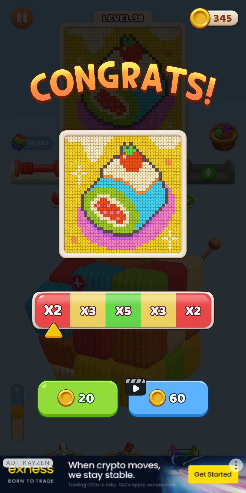
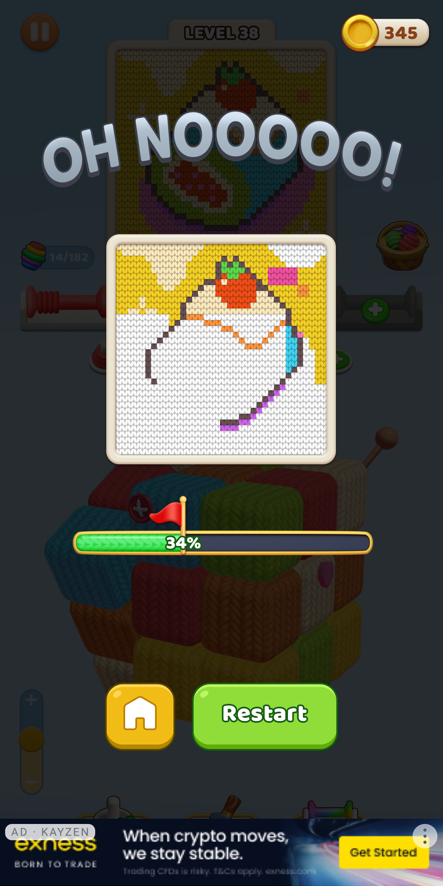

# F04 — Progression và kinh tế trong game

## Tiến trình

- Người chơi bắt đầu từ level 1.
- Hoàn thành level để mở level kế tiếp.
- Home hiển thị một dải level gần vị trí hiện tại.
- Level Hard/Very Hard là điểm nhấn trong campaign, không phải chế độ riêng ở MVP.

## Tài nguyên

### Coin
Dùng cho các lựa chọn cứu ván, mua booster hoặc các offer trong shop.

### Heart
Giới hạn số lần chơi/thất bại theo session sản phẩm. Hiện tại cấu hình có tối đa 5 heart và hồi theo thời gian.

### Infinite Heart
Thời lượng chơi không tốn heart, nhận từ daily reward, bundle hoặc offer.

### Booster inventory
Ba loại booster có số lượng tồn riêng: Add Slot, Clean, Magic Box.

## Reward sau thắng

- Coin cơ bản.
- Có thể xem rewarded ad để nhân đôi.
- Có thể nhận thêm heart theo cấu hình.
- Kết quả hiển thị rõ trước khi người chơi bấm nhận.

## Daily reward

Chu kỳ 7 ngày gồm coin, heart-time và booster. Người chơi có thể claim thường, claim x2 bằng ad hoặc recover ngày bỏ lỡ bằng ad.

## Nguyên tắc kinh tế

- Người chơi luôn có cách chơi thử mà không phải mua.
- Offer phải xuất hiện sau một thời điểm có ý nghĩa, không chặn onboarding.

- Giá và reward cần cấu hình được.
- Không trừ coin/booster nếu giao dịch thất bại.
- Mọi reward phải có thông báo nguồn nhận.

## MVP không làm

Không xây marketplace, trading, account cloud save hoặc battle pass.
